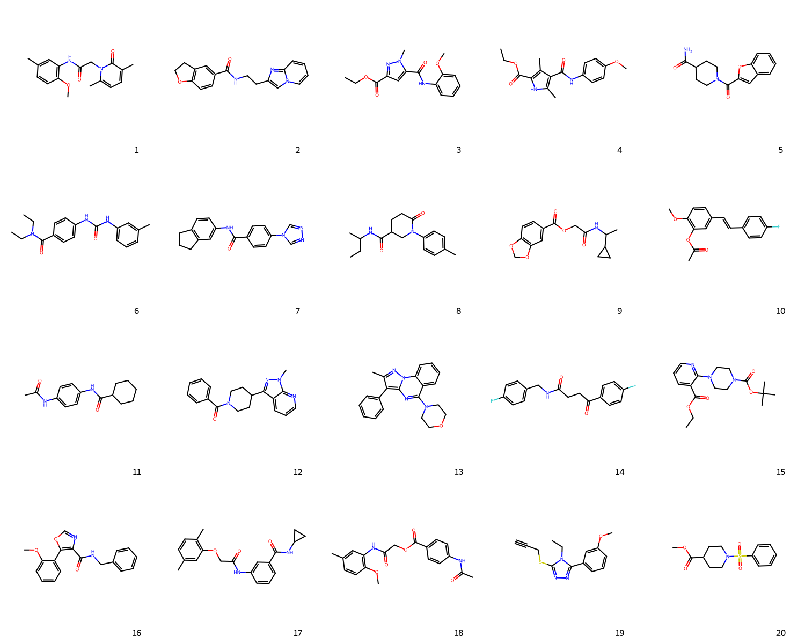
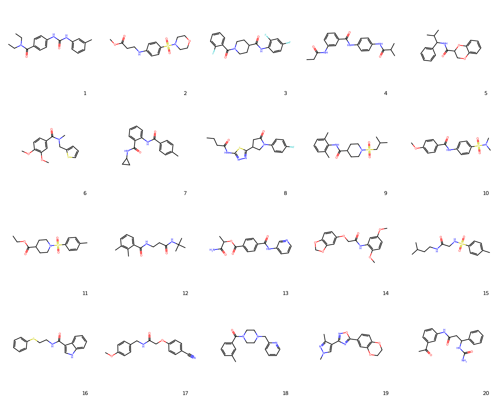
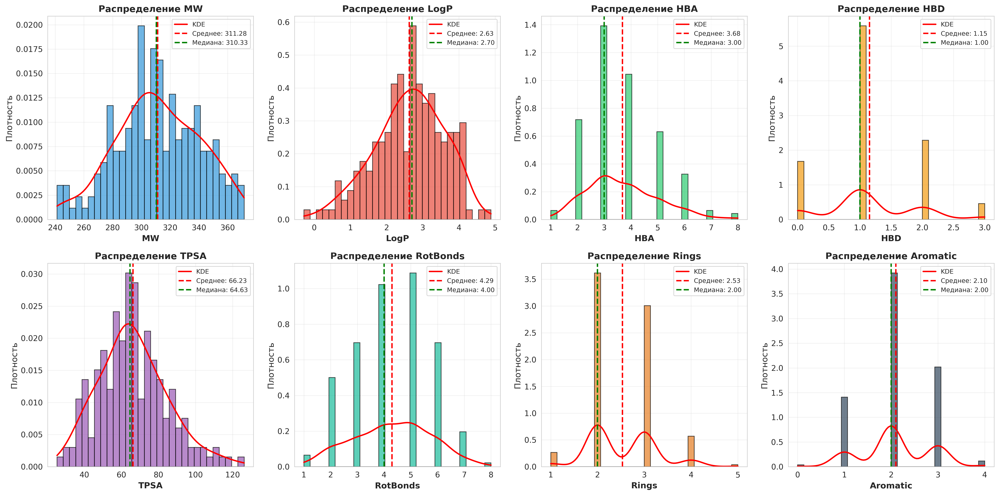

# Molecular Transformer

Генерация молекулярных структур (SMILES) с помощью decoder-only трансформера на датасете MOSES.

## Результаты

Сгенерированные молекулы (Top 20):



Сгенерированные молекулы (Random 20):



Распределение молекулярных свойств (MW, LogP, HBA, HBD, TPSA, RotBonds, Rings, Aromatic):



## Установка

```bash
pip install -r requirements.txt
```

## Запуск

Обучение модели:
```bash
python src/train_standalone.py
```

Генерация молекул:
```bash
python src/generate_logged.py --num 50 --validate
```

Построение графиков и структур молекул:
```bash
python src/visualize_results.py
```

## Структура

- `src/model_decoder.py` — архитектура трансформера
- `src/Tokenizer.py` — токенизатор SMILES
- `src/dataset.py` — загрузка датасета MOSES
- `src/train_standalone.py` — обучение модели
- `src/generate_logged.py` — генерация молекул
- `src/visualize_results.py` — визуализация молекул и свойств
- `src/validate.py` — валидация через RDKit
