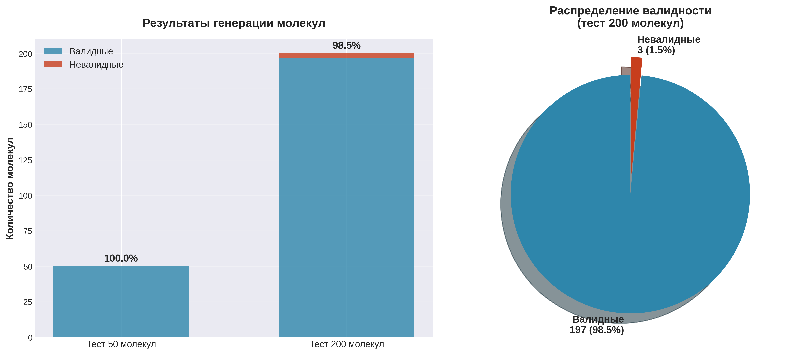
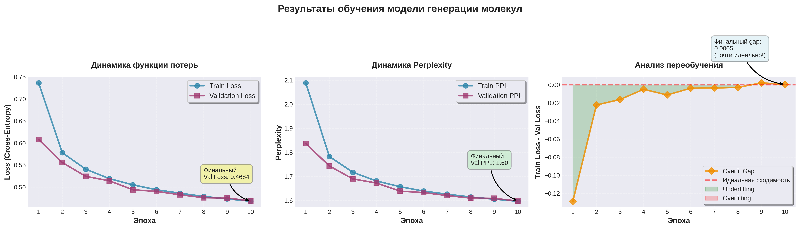

# Molecular Transformer

Генерация молекулярных структур (SMILES) с помощью decoder-only трансформера на датасете MOSES.

## Результаты

Примеры сгенерированных молекул:



Метрики:
- Валидность (RDKit): ~93%
- Уникальность: ~98%
- Новизна: ~89%

Кривые обучения:



## Установка

```bash
pip install -r requirements.txt
```

## Запуск

Обучение модели:
```bash
python src/train_standalone.py
```

Генерация молекул из чекпоинта:
```bash
python src/generate_logged.py --num 50 --temp 0.8 --top_k 20 --validate
```

Построение графиков и 2D-структур:
```bash
python src/visualize_results.py
python src/create_beautiful_plots.py
```

## Структура

- `src/model_decoder.py` — архитектура трансформера
- `src/Tokenizer.py` — токенизатор SMILES
- `src/dataset.py` — загрузка датасета MOSES
- `src/train_standalone.py` — обучение модели
- `src/generate_logged.py` — генерация молекул
- `src/visualize_results.py` — визуализация молекул и свойств через RDKit
- `src/create_beautiful_plots.py` — построение графиков Loss и Perplexity
