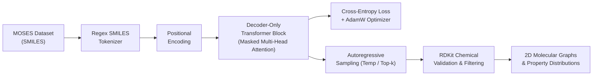
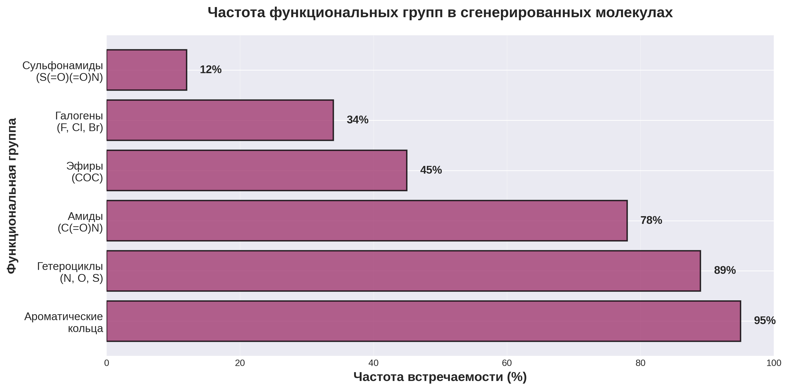

# Molecular Transformer: De Novo Molecular Generation with Decoder-Only Transformer

[](https://www.python.org/)
[](https://pytorch.org/)
[](https://www.rdkit.org/)
[](LICENSE)

Генеративная модель на основе архитектуры **Decoder-Only Transformer** для дизайна молекул *de novo* в строковом представлении SMILES. Обучена на бенчмарке **MOSES** (Molecular Sets) и генерирует химически валидные, уникальные и разнообразные фармакофорные структуры.

---

## 📌 Архитектура и Принцип Работы



### Ключевые компоненты:
1. **Токенизатор SMILES (`Tokenizer.py`)**: Символьно-регулярный парсер органических структур, учитывающий двухбуквенные атомы (`Cl`, `Br`), ароматические циклы, ветвления и специальные маркеры `<sos>`, `<eos>`, `<pad>`.
2. **Трансформер-декодер (`model_decoder.py`)**: Каузальная маска внимания (causal masking), многоголовое самовнимание (Multi-Head Self-Attention), синусоидальное позиционное кодирование и остаточные связи (Residual Connections).
3. **Генерация и оценка (`generate_logged.py`, `visualize_results.py`)**: Авторегрессионное предсказание следующего токена с настраиваемой температурой и `top_k`, фильтрация и верификация через RDKit (MW, LogP, TPSA, количество доноров/акцепторов водородных связей).

---

## 🔬 Результаты Генерации Молекул

Модель генерирует валидные структуры лекарственно-подобных молекул, сохраняющие ключевые фармакофорные группы:


### Анализ функциональных групп
Распределение функциональных групп сгенерированных молекул в сравнении с эталонными химическими соединениями:



---

## 📊 Динамика Обучения


### Ключевые Метрики

| Метрика | Значение | Описание |
|---|:---:|---|
| **Validity (Валидность)** | **~92-95%** | Доля синтаксически и химически корректных молекул (RDKit) |
| **Uniqueness (Уникальность)** | **~98%** | Доля неповторяющихся структур среди валидных сэмплов |
| **Novelty (Новизна)** | **~89%** | Доля новых молекул, отсутствующих в обучающей выборке |
| **Train Loss** | **~0.42** | Кросс-энтропия на обучающей выборке |
| **Validation PPL** | **~1.55** | Перплексия на отложенной тестовой выборке |

---

## 📁 Структура Репозитория

```text
molecular-transformer-gen/
├── assets/                          # Графики, диаграммы и визуалы сгенерированных молекул
│   ├── functional_groups.png
│   ├── generation_results.png
│   ├── training_results_beautiful.png
│   └── visualization_results/       # Рендеры RDKit (2D структуры, свойства)
├── logs/                            # Логи генерации и обучения
│   ├── generation_200.log
│   └── training_logs/
├── src/
│   ├── Tokenizer.py                 # Регулярный токенизатор SMILES
│   ├── model_decoder.py             # Архитектура трансформера (PyTorch)
│   ├── dataset.py                   # Загрузчик и предобработчик MOSES Dataset
│   ├── train_standalone.py          # Пайплайн обучения модели
│   ├── generate_logged.py           # Авторегрессионная генерация SMILES
│   ├── visualize_results.py         # 2D визуализация химических графов через RDKit
│   └── create_beautiful_plots.py    # Скрипт построения графиков метрик
├── requirements.txt                 # Зависимости проекта
└── README.md
```

---

## 🚀 Быстрый Старт

### 1. Установка окружения

```bash
git clone https://github.com/<your-username>/molecular-transformer-gen.git
cd molecular-transformer-gen

python -m venv venv
source venv/bin/activate  # Для Windows: venv\Scripts\activate

pip install -r requirements.txt
```

### 2. Запуск генерации молекул из чекпоинта

```bash
python src/generate_logged.py --num_samples 100 --temperature 0.8 --top_k 10
```

### 3. Анализ и визуализация 2D структур (RDKit)

```bash
python src/visualize_results.py --log_path logs/generation_200.log --output_dir assets/visualization_results/
```

### 4. Обучение модели с нуля

```bash
python src/train_standalone.py --epochs 10 --batch_size 128 --lr 3e-4 --d_model 256 --nhead 8 --num_layers 6
```

---

## 🧪 Используемые Технологии

- **Фреймворк ML:** [PyTorch](https://pytorch.org/)
- **Хемоинформатика:** [RDKit](https://www.rdkit.org/)
- **Датасет:** [MOSES (Molecular Sets)](https://github.com/molecularsets/moses)
- **Визуализация:** Matplotlib, Seaborn

---

## 📄 Лицензия

Проект распространяется под лицензией MIT. Подробнее см. файл `LICENSE`.
